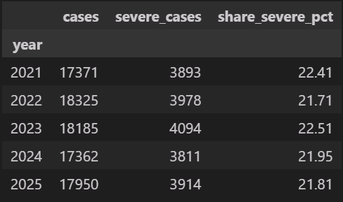
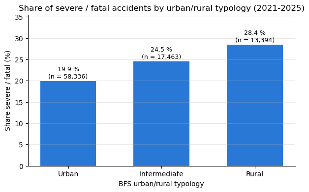
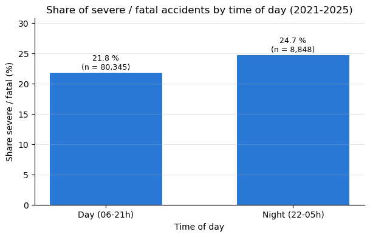
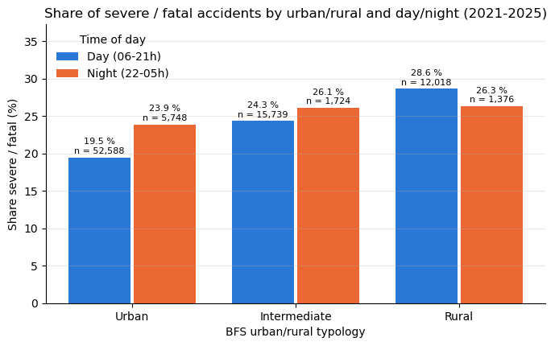
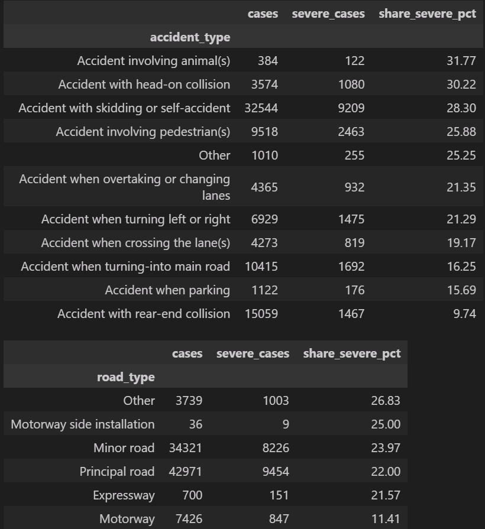
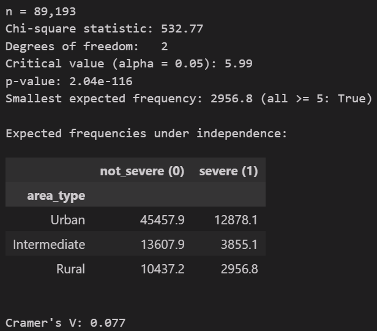
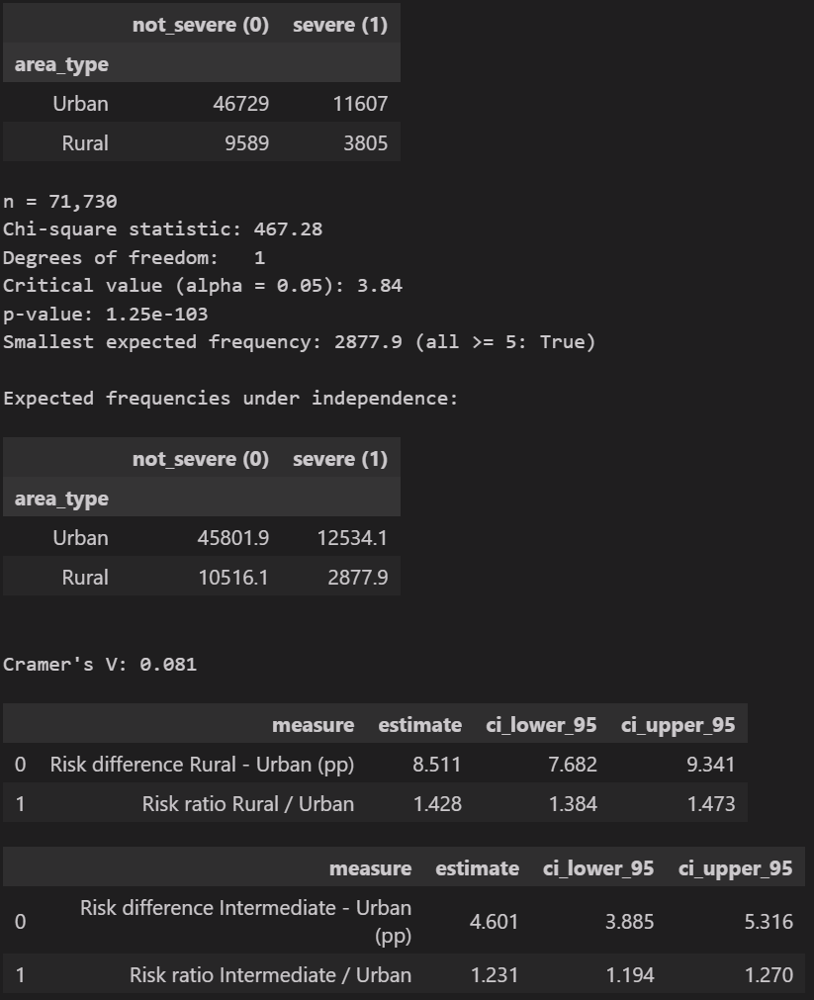
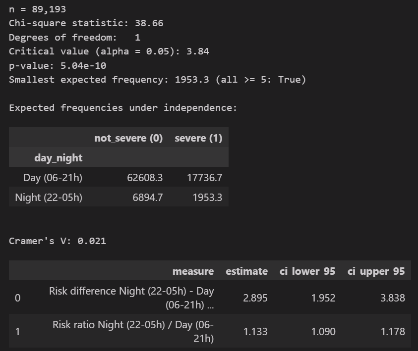

# Swiss Road Accident Severity Analysis

**Data Analytics Project | ZHAW**

**Research Question:**  
Which factors are associated with road accident severity in Switzerland, and what role does the urban-rural classification play?

**Hypotheses:**

- H1: Accidents in rural areas are more likely to be severe than accidents in urban areas.
- H2: Accidents at night are more likely to be severe than accidents during the day.

---

# 1. Data

## 1.1 Data Sources

- ASTRA: Swiss road accident data (2021–2025)
- BFS: Municipality urban-rural classification

## 1.2 Data Collection

- Swiss road accident is retrieved thru the STAC-API from data.geo.admin
- BFS: Municipality data is revtrieved from the csv from bfs.admin.ch

## 1.3 Data Cleaning

- Identified missing values, datatypes and duplicates
- Preperation for municipality "GDE-Nummer" for the integration
- Renamed Columns for prequet and final data set

## 1.4 Data Integration

- The data from BFS Municipality was merged (left join) with the traffic accident data on the gde number
- 89'544 accidents could be paired with the correct municipality 351 (0,39) accidents could not be assigned
- Added catagorical variable: area_type
- Added two binäry variables: severe and night

## 1.5 Feature Engineering

- severe: 0=leichte Verletzung, 1=schwere/tödliche Verletzung
- night: 0=Tag, 1=Nacht(22-06 Uhr)
- area_type: Urban, Intermediate, Rural

## 1.6 Data Storage

- The parquet data set features the data without any missing values.
- The entire accident data set was stored in the sql-database.

## 1.7 Data Quality

351 Values could not be assigned with a BFS-Municipality. Data loss of 0.39%

---

# 2. Exploratory Data Analysis (EDA)

## 2.1 Dataset Overview

| Dataset characteristic | Value |
|---|---:|
| Accidents | 89,193 |
| Unique accident IDs | 89,193 |
| Period | 2021-2025 |
| Municipalities represented | 2,030 |
| Cantons represented | 26 |

| Accident severity | Accidents | Share | `severe` |
|---|---:|---:|---:|
| Light injuries | 69,503 | 77.92% | 0 |
| Severe injuries | 18,599 | 20.85% | 1 |
| Fatalities | 1,091 | 1.22% | 1 |
| **Total** | **89,193** | **100%** | |

The cleaned dataset contains one row per accident with personal injury in Switzerland from 2021 to 2025. Most accidents involve light injuries; 19,690 accidents (22.08%) involve severe injuries or fatalities and form the `severe = 1` group. These figures describe recorded injury accidents, not accident risk per kilometre driven. Percentages may not sum to 100% because of rounding.

## 2.2 Accident Severity

<!-- Distribution of severity levels -->

The table shows data with traffic acccident data from the year 2021-2025. Each year shows the amount of severe cases recoreded with the percentage of compared to all cases in that year.

## 2.3 Urban vs. Rural

The BFS classification distinguishes Urban, Intermediate and Rural municipalities. The table shows the share of severe or fatal outcomes among recorded injury accidents in each group (2021-2025).

| Area type | Accidents | Severe or fatal accidents | Share severe or fatal |
|---|---:|---:|---:|
| Urban | 58,336 | 11,607 | 19.90% |
| Intermediate | 17,463 | 4,278 | 24.50% |
| Rural | 13,394 | 3,805 | 28.41% |

The share increases from urban to intermediate to rural municipalities, supporting the direction of H1. The rural share is 8.51 percentage points higher than the urban share. This describes severity given an injury accident; it does not establish a causal effect or a higher accident risk per kilometre driven. Differences in accident type, road type and other circumstances may contribute to the association.

## 2.4 Day vs. Night

<!-- Severity differences by time of day -->

**Interpretation:** At night (22:00-05:59) the share of severe/fatal accidents is higher than during the day, which is the direction expected by H2. The difference is visibly smaller than between urban and rural. Night accidents are a much smaller group, so their share is estimated less precisely

**Interpretation:** The night effect is not the same everywhere: in urban municipalities the share at night is clearly higher than during the day, in intermediate municipalities the difference is smaller, and in rural municipalities the night share is not higher than the day share in the current output (point estimate even lower, but based on a small night group).

## 2.5 Additional Factors

<!-- Accident types, road types and temporal patterns -->

This Table shows the categorical variables `accident_type ` and `road_type` and the numbers which cases they are included in from the year 2021-2025.

## 2.6 Statistical Tests

<!-- Chi-square tests and significance -->

### H1 Urban / rual (area_type)

- H0: Severity is independent of the urban/rural typology.
- H1: Severity depends on the urban/rural typology.

**Chi-square test 3x2 (Urban / Intermediate / Rural x severe)**

**Chi-square test 2x2 (Rural vs. Urban) and effect sizes**

**Interpretation:** In both tests the χ² statistic is far above the critical value and the p-value is practically zero, so H0 (independence) is rejected for the 3x2 and the 2x2 table. All expected frequencies are far above 5, so the χ² approximation is valid.

### H2 Day and Night

- H0: Severity is independent of day/night.
- H1: Severity depends on day/night.

**Chi-square test 2x2 (night x severe) and effect sizes**

**Interpretation:** The χ² test rejects independence (p far below 0.05, all expected frequencies far above 5). Cramér's V, however, is very small, and the risk difference is only a few percentage points (CI excludes 0, risk ratio CI excludes 1). With almost 90,000 accidents even small differences become significant, so H2 is supported in direction but the bivariate effect is weak. The night definition is based on clock time and not on actual darkness.

---

# 3. Modeling

Notebook: `nootebooks/03_model.ipynb`

## 3.1 Model Selection

The target `severe` is binary (0/1), so a **multiple logistic regression** (`statsmodels` Logit) is used. It looks at urban/rural and day/night *at the same time* while holding accident type, road type and year constant. The exponentiated coefficients are **odds ratios (OR)**: OR > 1 means higher odds of a severe outcome than the reference group, OR < 1 lower odds. An OR is not a ratio of probabilities.

## 3.2 Model Preparation

| Role | Variable | Reference category |
|---|---|---|
| Target | `severe` (1 = severe/fatal, 0 = light) | – |
| H1 | `area_type` (Urban / Intermediate / Rural) | Urban |
| H2 | `night` (22:00-05:59) | Day |
| Controls | `accident_type`, `road_type`, `year` (categorical, one-hot) | most frequent category / 2021 |

- Intermediate municipalities stay a separate group (BFS: "dense periurban area and rural centres"); for H1 the OR *Rural vs. Urban* is decisive. Sensitivity check without them: OR Rural 1.48 (CI 1.28-1.71), practically unchanged.
- "Motorway side installation" (36 accidents) is merged into "Motorway" to avoid an unstable estimate.
- Stratified train/test split 80/20 (`random_state=42`): 71,354 training and 17,839 test accidents, 22.08 % severe in both.

## 3.3 Model Training

- **Model 1 (main model):** `severe ~ area_type + night + accident_type + road_type + year`, estimated on the training data.
- **Cluster-robust standard errors by municipality** (2,009 clusters), because accidents in the same municipality are not independent.
- Step-by-step models (adding one control at a time) show how the raw effects change.
- **Model 2:** adds the interaction `area_type × night`, to test whether the night effect differs by area type.

## 3.4 Model Evaluation

Test data (17,839 accidents, 3,938 severe):

| Model | Accuracy | Precision | Recall | F1 | ROC-AUC |
|---|---:|---:|---:|---:|---:|
| Baseline "always light" | 0.779 | 0.000 | 0.000 | 0.000 | 0.500 |
| Baseline "always severe" | 0.221 | 0.221 | 1.000 | 0.362 | 0.500 |
| Model 1, threshold 0.50 | 0.779 | 0.000 | 0.000 | 0.000 | 0.622 |
| Model 1, threshold 0.21 | 0.527 | 0.279 | 0.720 | 0.402 | 0.622 |

- With threshold 0.5 the model predicts no severe accident (all predicted probabilities < 0.4), the result equals the majority baseline. The high accuracy only reflects the class imbalance.
- The threshold 0.21 was chosen on the **training data** (maximum F1) and then applied to the test data.
- Training values are almost identical (ROC-AUC 0.632 vs. 0.622), so there is no overfitting. The predictive power is weak (McFadden pseudo R² 0.037).

## 3.5 Model Interpretation

| | Raw OR | Adjusted OR, model 1 (95 % CI, cluster-robust) | p |
|---|---:|---|---:|
| Rural vs. Urban | 1.60 | 1.49 (1.29-1.72) | < 0.001 |
| Intermediate vs. Urban | 1.31 | 1.27 (1.10-1.47) | 0.001 |
| Night vs. Day | 1.18 | 0.97 (0.91-1.03) | 0.32 |

- The rural effect remains after controlling for accident type, road type and year.
- The raw night difference disappears as soon as the accident type is added (OR 1.18 -> 0.95): about 69 % of night accidents are skidding or self-accidents (day: about 33 %), a type with an above-average share of severe outcomes.
- Model 2: the night effect differs by area type (joint Wald test p < 0.001). Urban: OR 1.06 (n.s.), Intermediate: 0.90 (n.s.), Rural: 0.76 (0.66-0.89).
- The accident type itself has the strongest association with severity (e.g. rear-end collisions OR 0.30 vs. skidding/self-accidents).

---

# 4. Conclusions

## 4.1 Key Findings

- Severe or fatal outcomes are more likely, in terms of odds, in rural than in urban municipalities, also with the same accident type, road type and year.
- The higher share of severe accidents at night is explained by the different mix of accident types at night.
- The model is suitable for describing associations (odds ratios with confidence intervals), but it explains only a small part of the severity and predicts single accidents only weakly (ROC-AUC 0.62).

## 4.2 Hypothesis Evaluation

- **H1 (rural > urban): supported.** Significant in the χ² test (EDA) and in the adjusted model (OR 1.49, CI 1.29-1.72).
- **H2 (night > day): supported only bivariate.** Significant in the χ² test, but not in the adjusted model (OR 0.97, CI 0.91-1.03). In rural municipalities the adjusted night odds are even lower than during the day.

## 4.3 Limitations

<!-- Data quality, assumptions, methodological limitations -->

- Night is defined by clock time (22:00-05:59), not by actual darkness.

- Associations only, no causal statements. Differences between groups can be caused by other factors (speed, road type, accident type, alcohol, weather) that are only partly controlled in the model.

- Only accidents **with personal injury** are recorded; accidents with property damage only are missing. The analysis compares severity _given_ an injury accident, not accident risk. No exposure data (traffic volume, kilometres driven): more accidents in a region or hour does not mean higher risk.

- Large n: almost every difference becomes statistically significant, therefore the effect sizes are reported.

- Accidents within the same municipality are not independent; this is addressed in `03_model.ipynb` with cluster-robust standard errors.

- Class imbalance (22 % severe): with the default threshold 0.5 no severe accident is predicted; accuracy alone is misleading.

- Important factors (speed, alcohol, weather, vehicle type, protective equipment) are not in the model, which explains the weak predictive power.

- The accident type may itself be part of the reason why night accidents are more severe; "no night effect with the same accident type" does not mean that night is irrelevant.

## 4.4 Final Conclusion

Severity of injury accidents in Switzerland is associated with the urban/rural typology (H1 supported, also after adjustment) and strongly with the accident type. The day/night difference (H2) is only visible bivariate and is explained by the accident type in the multiple model. All results are associations, not causal effects.

---

## AI Usage Documentation

<!-- How was AI used during the project? -->

Tools: Claude Code (model Claude Opus 5.5) in VsCode

### Creating Task

- Set up the branch eda, create this notebook (structure, helper functions for x2 / Cramér's V / risk
  difference / risk ratio, plots, maps) and draft the interpretations.

### What helped

- Fast setup of reusable functions (same analysis for H1 and H2), formulas for the effect sizes and
  confidence intervals, CRS check of the geojson, first drafts of the interpretations.
